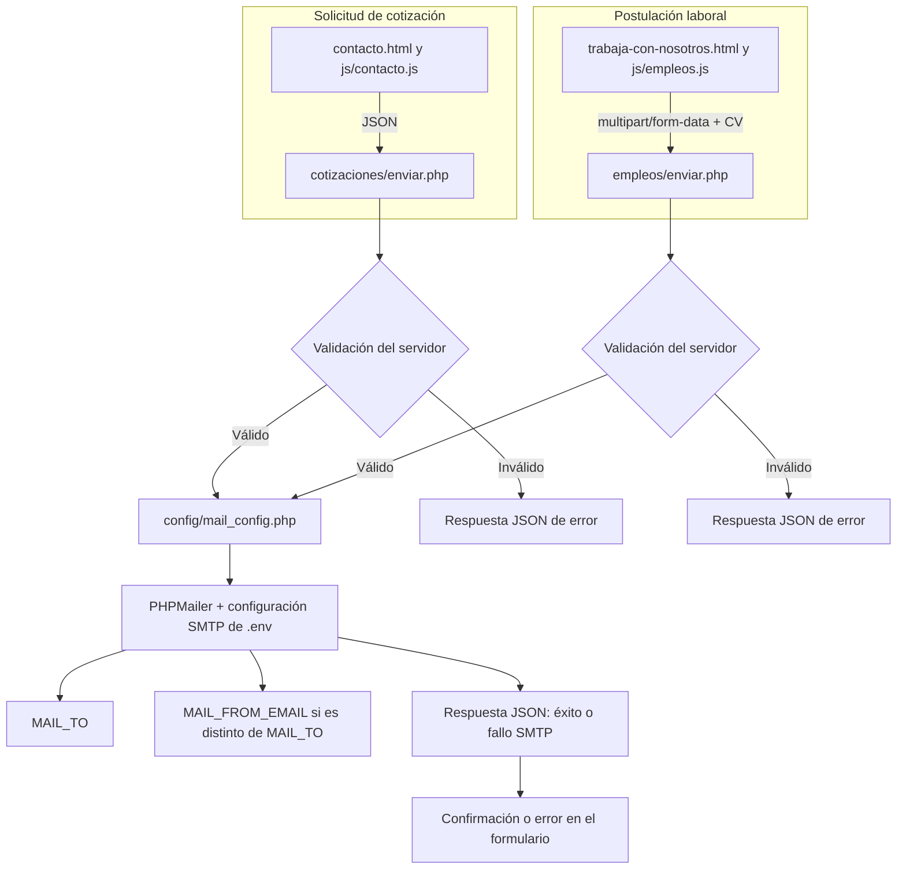
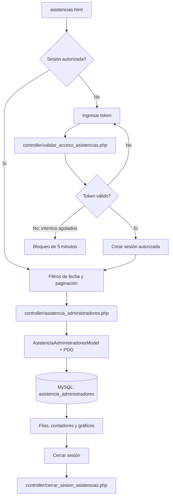

# Adminio 🏦

[](https://www.linkedin.com/in/drphp/)
[](https://www.linkedin.com/in/drphp/)

<a href="https://www.instagram.com/amvsoft.tech/">
  
</a>

## Descripción

Sitio web corporativo de ADMINIO Perú para administración inmobiliaria. Incluye páginas públicas, formularios de cotización y postulación, un blog informativo y un panel de consulta de asistencias protegido por token.

## Stack

- Frontend: HTML, CSS y JavaScript sin framework.
- Backend: PHP 8+, Composer y PHPMailer para correo SMTP.
- Datos del panel: MySQL/MariaDB mediante PDO.
- Dependencias del panel público: librerías cargadas desde CDN (DataTables, Flatpickr, ApexCharts y AlertifyJS).

## Requisitos

- PHP 8 o superior con `openssl`, `fileinfo`, `pdo` y `pdo_mysql` habilitados.
- Composer 2.
- Apache u otro servidor web con soporte PHP. El servidor integrado de PHP sirve para desarrollo.
- Acceso SMTP para los formularios.
- MySQL/MariaDB y acceso a la tabla `asistencia_administradores` para usar Asistencias.

## Puesta en marcha local

Desde la raíz del repositorio:

```sh
composer install
cp .env.example .env
php -S 127.0.0.1:8000
```

En Windows PowerShell, copiar el archivo con:

```powershell
Copy-Item .env.example .env
```

Completar `.env` con credenciales del entorno y abrir `http://127.0.0.1:8000/`. Para que funcionen correo y asistencias, configurar también SMTP y base de datos. Abrir las páginas con `file://` no ejecuta PHP ni permite que funcionen los endpoints.

## Configuración (`.env`)

La aplicación lee `.env` desde la raíz. `.env` está excluido del control de versiones; `.env.example` contiene valores ficticios y no debe usarse como configuración productiva.

| Variable | Uso |
| --- | --- |
| `MAIL_HOST` | Host SMTP. |
| `MAIL_PORT` | Puerto SMTP, por ejemplo `465` o `587`. |
| `MAIL_SECURE` | `ssl` para SMTPS o `tls` para STARTTLS. |
| `MAIL_USERNAME` / `MAIL_PASSWORD` | Credenciales SMTP. |
| `MAIL_FROM_EMAIL` / `MAIL_FROM_NAME` | Dirección y nombre remitente. |
| `MAIL_TO` | Destinatario principal de los formularios nuevos. |
| `DB_HOST`, `DB_PORT`, `DB_NAME` | Conexión MySQL/MariaDB. |
| `DB_USERNAME`, `DB_PASSWORD`, `DB_CHARSET` | Credenciales y codificación de base de datos. |
| `ASISTENCIAS_TOKEN` | Token de acceso al módulo de asistencias. |

Los endpoints de cotizaciones y empleos envían a `MAIL_TO` y, si es una dirección distinta, agregan copia a `MAIL_FROM_EMAIL`. La dirección proporcionada por la persona se utiliza como `Reply-To`. El formulario legacy del inicio mantiene el comportamiento de `config/envio_correo.php`.

## Flujos principales

### Páginas públicas y navegación

- `index.html` es la página de inicio. `head.html` y `footer.html` se comparten como fragmentos.
- `blog.html` y las páginas `blog-*.html` contienen los artículos; `js/blog.js` carga la navegación y controla búsqueda, filtros y calculadora.
- `contacto.html` permite solicitar un presupuesto. Su JavaScript carga las listas vinculadas de región, provincia y distrito desde `static/data/1_ubigeo_departamentos.json`, `2_ubigeo_provincias.json` y `3_ubigeo_distritos.json`.
- `trabaja-con-nosotros.html` recibe postulaciones y CV.

### Correo y formularios

- El formulario legacy de la página de inicio conserva el envío JSON a `config/envio_correo.php`, que usa `config/template_mail.html` y `css/template_mail.css`.
- La página nueva de contacto envía JSON a `cotizaciones/enviar.php`. El endpoint valida los datos, servicios seleccionados, teléfono peruano de 9 dígitos que comienza con 9 y límites de envío; genera correo HTML desde `cotizaciones/template_mail.html`.
- El formulario de empleos envía `multipart/form-data` a `empleos/enviar.php`. Valida consentimiento, teléfono y CV PDF (máximo 5 MB), adjunta el archivo al correo y no lo almacena en el sitio. La plantilla es `empleos/template_mail.html`.
- Ambos formularios nuevos comparten `config/mail_config.php`, PHPMailer y las variables SMTP de `.env`. Incorporan la imagen de cabecera correspondiente desde `static/`.

#### Flujo de correo



#### Flujo de acceso a asistencias



### Asistencias

- `asistencias.html` es un reporte protegido por sesión y por `ASISTENCIAS_TOKEN`.
- `controller/validar_acceso_asistencias.php` valida el token y bloquea durante cinco minutos después de tres intentos fallidos. Los otros controladores consultan el estado, devuelven registros filtrados y cierran sesión.
- `model/AsistenciaAdministradoresModel.php` consulta `asistencia_administradores` mediante `db/connection.php` y PDO. Los filtros de fecha y parámetros de paginación se envían como parámetros preparados.

## Estructura del repositorio

```text
.
├── index.html, contacto.html, trabaja-con-nosotros.html, blog*.html
├── head.html, footer.html
├── css/                  # Estilos del sitio y de las páginas
├── js/                   # Lógica del frontend
├── static/               # Imágenes, logos y catálogos JSON
├── config/               # Lectura de entorno, correo legacy y configuración compartida
├── cotizaciones/         # Endpoint y plantilla del formulario de contacto nuevo
├── empleos/              # Endpoint y plantilla de postulaciones
├── controller/           # Endpoints de asistencias
├── model/                # Consultas del reporte de asistencias
├── db/                   # Conexión PDO
├── .ia-context/          # Contexto y convenciones de desarrollo
├── composer.json         # Dependencias PHP
└── .env.example          # Referencia sin secretos
```

## Comprobaciones

No hay un comando de pruebas automatizadas configurado en `package.json` o Composer. Para revisar cambios, ejecutar las comprobaciones pertinentes:

```sh
php -l cotizaciones/enviar.php
php -l empleos/enviar.php
php -l config/mail_config.php
node --check js/contacto.js
node --check js/empleos.js
```

Las pruebas de integración requieren servidor PHP, credenciales SMTP válidas y, para Asistencias, conexión MySQL. Comprobar manualmente las respuestas de éxito y error de los formularios, CV válido/inválido y los filtros y sesión del reporte.

## Operación y seguridad

- No subir `.env`, contraseñas, tokens ni archivos con datos personales al repositorio.
- Proteger `.env` contra acceso HTTP y servir el sitio mediante HTTPS en producción.
- Configurar `upload_max_filesize` y `post_max_size` para aceptar el CV limitado a 5 MB.
- Los endpoints de cotizaciones y empleos aplican validación backend, campo honeypot y límites de frecuencia; los archivos temporales de control deben ser escribibles por PHP.
- Instalar dependencias con `composer install --no-dev --optimize-autoloader` en producción. No editar `vendor/` manualmente.
- Revisar la compatibilidad antes de cambiar nombres de campos, endpoints o estructura de respuestas consumida por JavaScript.

## Licencia

Uso privado/comercial según las políticas del propietario del repositorio.
