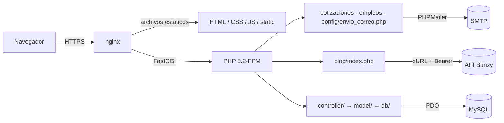

# Adminio 🏦

[](https://www.linkedin.com/in/drphp/)
[](https://www.linkedin.com/in/drphp/)

<a href="https://www.instagram.com/amvsoft.tech/">
  
</a>

Sitio corporativo de **ADMINIO Perú** (administración de edificios y condominios). Es un sitio HTML/CSS/JS sin framework con pocos endpoints PHP:

| Módulo | Entrada | Backend | Persistencia |
| --- | --- | --- | --- |
| Landing y páginas institucionales | `index.html`, `nosotros.html`, `servicios.html`… | — | — |
| Cotización | `contacto.html` + `js/contacto.js` | `cotizaciones/enviar.php` | Correo SMTP |
| Formulario legacy del inicio | `index.html` + `js/adminio.js` | `config/envio_correo.php` | Correo SMTP |
| Postulaciones | `trabaja-con-nosotros.html` + `js/empleos.js` | `empleos/enviar.php` | Correo SMTP (CV adjunto, no se almacena) |
| Blog dinámico | `/blog`, `/blog/<slug>`, `/blog/tag/<tag>`, `/blog/sitemap.xml` | `blog/index.php` → API Bunzy | Bunzy (headless CMS) |
| Blog estático (legacy) | `blog-*.html` | — | Archivos HTML |
| Asistencias (privado) | `asistencias.html` | `controller/*.php` → `model/` → `db/` | MySQL/MariaDB |

## Stack

- **Frontend:** HTML5, CSS y JavaScript vanilla. Librerías por CDN solo en Asistencias (DataTables, Flatpickr, ApexCharts, AlertifyJS).
- **Backend:** PHP 8.2 (FPM) y Composer con `phpmailer/phpmailer` ^7 y `league/commonmark` ^2.7. Requiere `ext-curl`.
- **Datos:** MySQL/MariaDB mediante PDO con consultas preparadas.
- **Contenido del blog:** API REST de Bunzy (`/api/v1`), consumida desde el servidor con Bearer token.
- **Producción:** VPS Ubuntu con nginx, PHP 8.2-FPM y TLS de Let's Encrypt.

## Arquitectura



Decisiones de diseño:

- **Sin build step.** Lo que está en el repositorio es lo que se sirve. Los scripts de `scripts/` generan contenido una sola vez y no son parte del despliegue.
- **Secretos solo en el servidor.** `config/env.php` lee `.env`. En el blog, `getenv()` tiene prioridad sobre `.env`, así que se pueden usar variables de entorno de FPM. La API key de Bunzy nunca llega al navegador.
- **Fallo explícito.** Si Bunzy no está disponible o rechaza la autenticación, el blog responde 503. Un slug inexistente devuelve 404 y un listado vacío, 200. Las respuestas del blog llevan `Cache-Control: no-store`.

## Requisitos

- PHP ≥ 8.2 con `curl`, `mbstring`, `openssl`, `fileinfo`, `pdo` y `pdo_mysql`.
- Composer 2.
- Node.js ≥ 20, solo para pruebas y scripts auxiliares.
- Credenciales SMTP, base de datos MySQL con la tabla `asistencia_administradores` y API key de Bunzy, según el módulo que se vaya a usar.

## Desarrollo local

```sh
composer install
cp .env.example .env          # PowerShell: Copy-Item .env.example .env
php -S 127.0.0.1:8000 tools/blog-router.php
```

`tools/blog-router.php` imita las reglas de producción: enruta `/blog` y bloquea `config/`, `tools/`, `vendor/`, archivos ocultos y archivos de Composer. Abrir `http://127.0.0.1:8000/`. Abrir los HTML con `file://` no ejecuta PHP.

## Configuración (`.env`)

`.env` vive en la raíz y no se versiona. `.env.example` es la plantilla de referencia y solo contiene valores ficticios.

| Variable | Uso |
| --- | --- |
| `MAIL_HOST`, `MAIL_PORT`, `MAIL_SECURE` | Servidor SMTP (`ssl` → 465, `tls` → 587). |
| `MAIL_USERNAME`, `MAIL_PASSWORD` | Credenciales SMTP. |
| `MAIL_FROM_EMAIL`, `MAIL_FROM_NAME` | Remitente. |
| `MAIL_TO` | Destinatario de los formularios. Si `MAIL_FROM_EMAIL` es distinto, recibe copia. |
| `DB_HOST`, `DB_PORT`, `DB_NAME`, `DB_USERNAME`, `DB_PASSWORD`, `DB_CHARSET` | Conexión MySQL del módulo Asistencias. |
| `ASISTENCIAS_TOKEN` | Token de acceso a Asistencias. Debe ser largo y aleatorio. |
| `BUNZY_BLOG_API_URL` | Base de la API de Bunzy (`https://app.bunzy.io`). Debe ser HTTPS. |
| `BUNZY_BLOG_API_KEY` | API key de Bunzy. Solo se usa en el servidor. |

## Módulos

### Formularios y correo

- **Cotización:** `contacto.html` envía JSON a `cotizaciones/enviar.php`, que valida servicios, teléfono peruano (9 dígitos, empieza en 9), honeypot y límite de frecuencia. Usa la plantilla `cotizaciones/template_mail.html`. Región, provincia y distrito se cargan desde `static/data/*_ubigeo_*.json`.
- **Postulaciones:** `trabaja-con-nosotros.html` envía `multipart/form-data` a `empleos/enviar.php`, que valida consentimiento, teléfono y CV en PDF de hasta 5 MB. El CV se adjunta al correo y no se guarda en disco.
- **Legacy:** el formulario del inicio (`sendEmail()` en `js/adminio.js`) envía a `config/envio_correo.php` y espera `ok/message`. Este contrato no debe cambiarse.
- Los dos endpoints nuevos comparten `config/mail_config.php`. La dirección del visitante va solo en `Reply-To`.

### Blog

- **Dinámico:** `blog/index.php` resuelve la ruta, `config/bunzy.php` es el cliente HTTP (`getPosts`, `getPost`, `getTags`), `blog/render.php` convierte Markdown con CommonMark y arma SEO, Open Graph y JSON-LD, y `blog/view.php` renderiza la vista con `head.html` y `footer.html`. Los artículos aparecen solo cuando están **publicados** en Bunzy.
- **Estático (legacy):** los `blog-*.html` de la raíz se mantienen para no romper URLs indexadas. `blog.html` redirige con 301 a `/blog`.
- Detalle de la integración: [`.ia-context/BUNZY-BLOG.md`](.ia-context/BUNZY-BLOG.md).

### Asistencias

- `asistencias.html` requiere sesión y `ASISTENCIAS_TOKEN`. El token se compara con `hash_equals` y, tras 3 intentos fallidos, el acceso se bloquea 5 minutos.
- `controller/` expone validar, estado, consulta y cierre de sesión. `model/AsistenciaAdministradoresModel.php` consulta mediante `db/connection.php` con parámetros preparados para fechas y paginación.

## Estructura del repositorio

```text
.
├── *.html                 # Páginas públicas (index, contacto, servicios, blog-*.html legacy…)
├── head.html, footer.html # Fragmentos compartidos (también se usan en las vistas PHP del blog)
├── blog/                  # Blog dinámico Bunzy: router, render y vista
├── cotizaciones/          # Endpoint + plantilla del formulario de cotización
├── empleos/               # Endpoint + plantilla de postulaciones
├── controller/            # Endpoints de Asistencias
├── model/                 # Acceso a datos de Asistencias
├── db/                    # Conexión PDO
├── config/                # env(), cliente Bunzy, configuración de correo y endpoint legacy
├── css/, js/              # Estilos y lógica del frontend, un archivo por página o módulo
├── static/                # Imágenes, logos y catálogos JSON (ubigeo)
├── brand-reference/       # Identidad de marca y fuentes de los assets (no se usa en runtime)
├── deploy/nginx/          # Configuración nginx de producción
├── scripts/               # Generadores puntuales de contenido o assets (Node)
├── tools/                 # Router de desarrollo, servidor de vista previa y check del blog
├── tests/                 # Pruebas con node:test
├── .ia-context/           # Reglas, roles y documentación técnica para desarrollo asistido
├── composer.json/.lock    # Dependencias PHP
└── .env.example           # Plantilla de configuración sin secretos
```

## Calidad y pruebas

```sh
# Pruebas de frontend (node:test)
node --test tests/*.test.cjs

# Render del blog con datos sintéticos (requiere vendor/)
php tools/check-bunzy-render.php

# Lint
for f in blog/*.php config/*.php cotizaciones/*.php empleos/*.php controller/*.php model/*.php db/*.php; do php -l "$f"; done
node --check js/contacto.js && node --check js/empleos.js
```

No hay CI configurado. Antes de abrir un PR, ejecutar lo anterior y probar a mano los flujos afectados: envío correcto y con error de cada formulario, CV válido e inválido, `/blog` con y sin artículos, y el login y los filtros de Asistencias.

## Despliegue

Producción: VPS Ubuntu, `root /var/www/adminio.pe`, nginx y PHP 8.2-FPM.

1. Actualizar el código en el servidor y ejecutar `composer install --no-dev --optimize-autoloader`. No editar `vendor/`.
2. Mantener el `.env` del servidor. No sobrescribirlo con `.env.example`.
3. Si cambian las rutas o los bloqueos, aplicar `deploy/nginx/adminio.pe.conf` en `/etc/nginx/sites-available/adminio.pe` y ejecutar `nginx -t && systemctl reload nginx`.
4. Verificación rápida: `/blog` → 200, `/blog.html` → 301, `/.env` y `/config/env.php` → 403 o 404, y un envío de prueba de cada formulario.

nginx no lee `.htaccess`. Si el sitio se moviera a Apache, habría que replicar las reglas de `deploy/nginx/` con `mod_rewrite`.

## Seguridad

- No versionar `.env`, credenciales, tokens, CVs ni datos personales.
- nginx bloquea los archivos ocultos y `config/`, `tools/`, `vendor/`, `model/` y `db/`. La única excepción es `config/envio_correo.php`. Cualquier carpeta nueva con código interno debe agregarse a ese bloqueo.
- En producción, `.env` debe tener permisos `640`, legible solo por el usuario de PHP-FPM.
- Ajustar `upload_max_filesize` y `post_max_size` a 5 MB o más para los CV.
- Los endpoints de formularios aplican validación en el servidor, honeypot y límite de frecuencia. Los archivos temporales de control deben poder ser escritos por PHP.
- Cambiar nombres de campos, endpoints o la forma de las respuestas JSON rompe el frontend. Hay que actualizar ambos lados en el mismo PR.

## Documentación interna

| Documento | Contenido |
| --- | --- |
| [`.ia-context/AGENTS_ROLES.md`](.ia-context/AGENTS_ROLES.md) | Roles y alcance por área |
| [`.ia-context/FRONTEND_RULES.md`](.ia-context/FRONTEND_RULES.md) | Convenciones de frontend |
| [`.ia-context/BACKEND_RULES.md`](.ia-context/BACKEND_RULES.md) | Convenciones de backend |
| [`.ia-context/CONFIGURACION-ENVIOS.md`](.ia-context/CONFIGURACION-ENVIOS.md) | Entrega y configuración de formularios |
| [`.ia-context/CONTACTO-IMPLEMENTACION.md`](.ia-context/CONTACTO-IMPLEMENTACION.md) | Implementación de la página de contacto |
| [`.ia-context/BUNZY-BLOG.md`](.ia-context/BUNZY-BLOG.md) | Integración del blog con Bunzy |

## Licencia

Uso privado/comercial según las políticas del propietario del repositorio.
